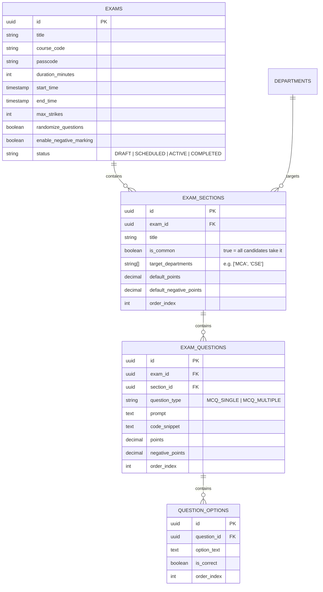
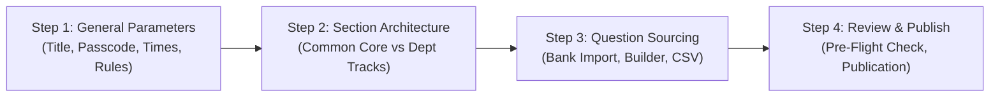

# KARE-SES: Exam Creation & Authoring Studio — Master Blueprint

---

## 1. Executive Summary & Objective

In an institutional university setting such as **Kalasalingam Academy of Research and Education (KARE)**, major examinations (e.g., **Ph.D Comprehensive Qualifying Examination**, **Postgraduate Entrance Assessments**, and **Institutional Benchmark Tests**) involve candidates from multiple faculties participating in the **same testing session** at the **same time**.

The **KARE-SES Exam Authoring Studio** (`/exams/new`) is engineered to support:
1. **Modular Section Architecture**: One unified exam paper with universal **Common Core sections** (General Aptitude, Research Methodology) and targeted **Department Specialization sections** (MCA, CSE, ECE, etc.).
2. **Zero-Friction Question Assembly**: Sourcing questions via:
   - **1-Click Import from Master Question Bank** (General Core or Department-specific).
   - **Direct Rich MCQ Builder** with code snippets.
   - **Multi-Section Bulk CSV Import**.
3. **Rigorous Security Lockdown**: Passcode generation, duration windows, strike thresholds, and Win32 hardware affinity lockdown policies.
4. **Candidate-Tailored Paper Generation**: When a candidate logs into the Windows desktop client using their **Email + Application Number + Passcode**, the server dynamically builds their individualized exam paper based on their registered department.

---

## 2. Exam Data Architecture



---

## 3. The 4-Step Authoring Workflow



### Step 1: General Parameters & Schedule
- **Examination Title**: Institutional designation (e.g. *Ph.D Research Qualifying Examination 2026*).
- **Curriculum / Course Code**: Shortcode (e.g. *KARE-PHD-2026*).
- **Access Passcode**: 6-character random cryptographic string (e.g. `K9X2P4`), with a 1-click **Regenerate** button.
- **Duration & Window**:
  - Exam duration in minutes (e.g. `90`, `120`, `180`).
  - Scheduled Start Time and End Time (datetime pickers).
- **Global Scoring & Anti-Cheating Defaults**:
  - **Randomize Questions**: Shuffles question & option order per workstation.
  - **Enable Negative Marking**: Toggle with default penalty ratio (`0.25` or `0.50`).
  - **Max Integrity Strikes**: Number of violation events (Alt+Tab, secondary monitors, face loss) before automated lockdown (Default: `3`).

---

### Step 2: Modular Section Routing (Multi-Department)
The exam can contain any number of sequential sections:

| Section Type | Description | Target Audience | Example Content |
| :--- | :--- | :--- | :--- |
| **Common Core (Part A)** | Mandated for all candidates (`is_common = true`). | **100% of Candidates** (all departments) | Research Methodology, Quantitative Reasoning, General Aptitude |
| **Department Track (Part B1)** | Targeted to specific departments (`is_common = false`). | **MCA, CSE Candidates** | Data Structures, Algorithms, Operating Systems |
| **Department Track (Part B2)** | Targeted to specific departments (`is_common = false`). | **ECE Candidates** | Signals & Systems, Digital VLSI Design |
| **Department Track (Part B3)** | Targeted to specific departments (`is_common = false`). | **MECH Candidates** | Thermodynamics, Fluid Mechanics |

> [!NOTE]
> Section departments are loaded dynamically from the live **`departments`** database table, eliminating hardcoded lists.

---

### Step 3: Question Sourcing & Assembly
Authors have 3 non-exclusive methods to populate questions:

#### Method A: 1-Click Import from Question Bank
- Section author clicks **"Import from Question Bank"**.
- A sliding drawer/modal appears:
  - If the section is **Common Core**: Pre-filters to **`⭐ General / Common Core`** questions (Research Methodology, Logical Reasoning).
  - If the section targets **`MCA`**: Pre-filters to **`MCA`** questions.
- Search by topic or difficulty.
- Author checks desired questions and clicks **"Import Selected Questions"**.
- Questions and options are cloned into the exam section (preserving master questions intact).

#### Method B: Visual Rich MCQ Builder
- Direct card builder supporting:
  - **MCQ Single Choice** (1 correct answer).
  - **MCQ Multiple Choice** (Multiple correct checkboxes).
  - Code snippet attachment with monospace syntax canvas.
  - Per-question points and negative marks overrides.
  - Clone, reorder (drag or up/down arrows), and delete.

#### Method C: Multi-Section Bulk CSV Upload
- Single CSV file capable of defining sections, target departments, questions, options, and points in one upload.

---

### Step 4: Pre-Flight Verification & Publication
Before committing to the live database, the studio provides an **Executive Pre-Flight Audit**:
- **Total Marks Calculation**: Sum of all section points.
- **Section Coverage**: Displays which departments are covered and checks for orphaned departments.
- **Question Completeness Check**: Flags questions missing correct answers or prompts.
- **Passcode Verification**: Displays the invigilator passcode for sharing in the exam hall.
- **Publication Actions**:
  - **Save as Draft**: Remains private in admin portal.
  - **Schedule & Publish**: Active and ready for Windows lockdown client logins at the scheduled start time.

---

## 4. Student Delivery Engine at Exam Time

When candidate logs in from the Windows Client:

```
[Candidate Input]
Email: candidate@klu.ac.in
Password: 9921004123 (Application No)
Passcode: K9X2P4
       │
       ▼
[/api/exam/auth Engine]
1. Validates Email + Password against Supabase Auth.
2. Identifies Candidate's Department Code (e.g. 'MCA').
3. Resolves Exam Sections:
   - Section 1 (Common): INCLUDED
   - Section 2 (Target: MCA, CSE): INCLUDED
   - Section 3 (Target: ECE): EXCLUDED
4. Shuffles questions & options if randomize_questions = true.
5. Returns signed session JWT + tailored questions payload.
```

---

## 5. Summary of Deliverables

1. **`admin-web/src/app/exams/new/`**:
   - `page.tsx`: Unified multi-step studio.
   - `components/GeneralSetupTab.tsx`: Dynamic scheduler, passcode generator, lockdown thresholds.
   - `components/SectionsTab.tsx`: Dynamic department badges pulled from database, common vs department tracks.
   - `components/QuestionBuilderTab.tsx`: Rich MCQ builder with code snippets.
   - `components/QuestionBankImportModal.tsx`: Drawer to import from General / Dept question banks.
   - `components/PreFlightAuditModal.tsx`: Verification scorecard before publishing.
   - `actions.ts`: Atomic transaction saving exam, sections, questions, and options.
2. **`admin-web/src/app/exams/[id]/`**:
   - Exam Management Console showing live metrics, active candidates, passcode display, and status toggles.

